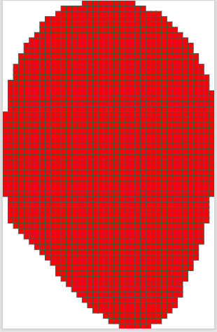
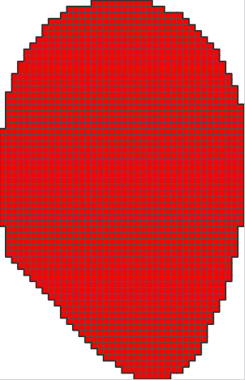
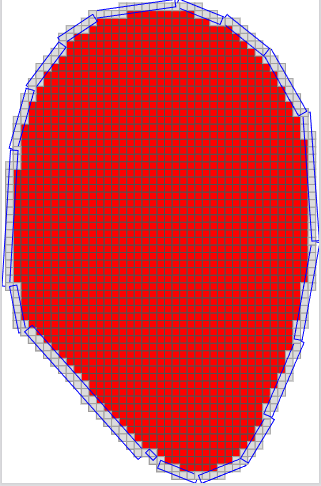
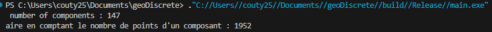

# TP1

## Step 2

J'obtiens un pdf pour chaque gris de riz comme l'image suivante, ce qui montre que je construits correctement mes commposantes connexes

## Step3

J'obtiens un contour qui suit mon composant comme demandé en choisissant d'abord une cellule au hasard avec findABel.  Ensuite avec track2DBoundaryPoints, on fait le tour du composant en stockant les points dans boundaryPoints. Et enfin on faitt une courbe de ces points en les transformants en vecteur avec initFromPointsVector

## Step 4

On utilise GreedySegmentation qui nous permet de segmenter le contour et obtenir l'image suivante :

## Step 5 

On compte les composants de la vomposante connexe via Objects[0] pour obtenir le résultat suivant : 
